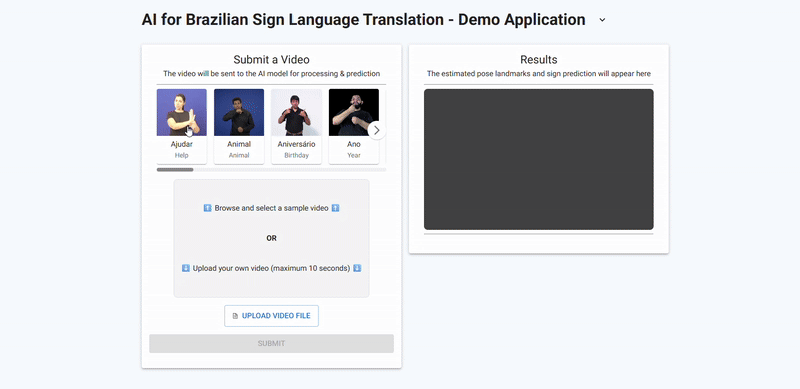

# Brazilian Sign Language Recognition Project

This is a collaborative data science project under the Omdena São Paulo Chapter focused on Brazilian Sign Language (Libras) recognition. The project aims to develop machine learning models that can classify sign language videos into corresponding Portuguese words.

The deliverables for this project consisted of a live demo application, the open source code, and a report of our work and results.

**Demo Application:**
[You can see the model in action and test it on your own videos in the **Demo App**](https://sao-paulo-brazil-chapter-brazilian-sign-language.vercel.app/).

<div align="center">

<p><em>GIF showing the demo application in action</em></p>
</div>

**Detailed Report:**
[This page has an overview of the project. For more details, jump to the **Report Page**](report)

**Open Source Code:**
You can find the project code and instructions for setup/usage in this  **Github Repo**


## Project Overview

See [STRUCTURE.md](STRUCTURE.md) for detailed project organization.

## Setup Instructions

### Prerequisites

1. Python 3.11 or higher
2. uv package manager (recommended installation via pip: `pip install uv`)

### Environment Setup

1. Clone the repository:
   ```bash
   git clone https://github.com/OmdenaAI/SaoPauloBrazilChapter_BrazilianSignLanguage.git
   cd SaoPauloBrazilChapter_BrazilianSignLanguage
   ```

2. Install core dependencies:
   ```bash
   uv sync
   ```
   For additional dependencies:
   ```bash
   uv sync --extra <group>  # Example: uv sync --extra data
   ```
   See `pyproject.toml` for available dependency groups (data, model, app).

3. Using the environment:
   ```bash
   # Activate the environment
   uv venv activate

   # Run your code
   python your_script.py
   jupyter notebook
   ```

   Or run commands directly without activation:
   ```bash
   uv run python your_script.py
   uv run jupyter notebook
   ```

4. Adding new dependencies:
   ```bash
   uv add <package>           # Add to core dependencies
   uv add --extra data <pkg>  # Add to data processing tools
   ```

## Project Structure

```
SaoPauloBrazilChapter_BrazilianSignLanguage/
├── data/                  # Data files
│   ├── raw/              # Original data
│   │   ├── INES/        # INES dataset
│   │   │   └── videos/  # Video files (stored on Google Drive)
│   │   ├── SignBank/    # SignBank dataset
│   │   │   └── videos/  # Video files (stored on Google Drive)
│   │   ├── UFV/         # UFV dataset
│   │   │   └── videos/  # Video files (stored on Google Drive)
│   │   └── V-Librasil/  # V-Librasil dataset
│   │       └── videos/  # Video files (stored on Google Drive)
│   ├── interim/          # Intermediate processing
│   │   ├── Analysis/    # Analysis info of the data
│   │   ├── Debug/       # Debug files for inspecting preprocessing steps
│   │   ├── RawCleanVideos/ # The raw video files after some initial cleaning before the preprocessing pipeline
│   │   ├── RawMotionMeasurements/ # Raw motion measurements
│   │   └── RawPoseLandmarks/ # Raw pose landmarks
│   ├── preprocessed/        # Final datasets
│   │   ├── metadata_v*.csv # Metadata for each preprocessing version
│   │   ├── videos/      # Preprocessed videos
│   │   │   └── v*/      # Version-specific processed videos (e.g., v1, v2, v3...)
│   │   └── landmarks/   # Processed landmark data
│   │       └── v*/      # Version-specific processed landmarks (e.g., v1, v2, v3...)
├── code/                 # Source code
│   ├── data/            # Data processing
│   ├── models/          # Model implementations
├── modelling/            # Model training and evaluation
│   ├── logs/            # Logs
│   ├── model_files/     # Model files
└── tests/               # Unit tests
```

See [STRUCTURE.md](STRUCTURE.md) for complete structure details.

## Data Management

### Video Files
- Large video files are stored on Google Drive
- Video directories in the repository structure are placeholders
- Download videos to your local `videos/` directories as needed
- Preprocessing pipeline creates versioned outputs (v1, v2, v3...) of processed videos and landmarks
- Each version has its own metadata and individual file metadata

### Data Files
- Small files like CSV files, labels, and metadata are tracked in Git
- Store processed data (features, embeddings) in `preprocessed/`
- Document data formats in respective directories
- Metadata files track preprocessing steps and configurations